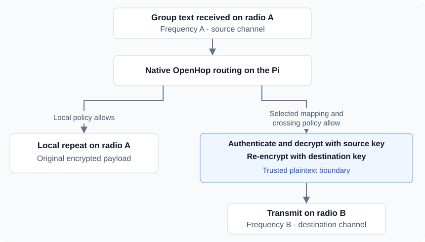

# Kesh's OpenHop bridge

A personal OpenHop project for a Pi with two radios on different frequencies: keep local repeating and selectively translate channel messages to the other radio.

The bridge authenticates and decrypts a selected group message with its source channel key, then re-encrypts it with the destination channel key. An optional **iLink (Internet Link)** connects the Pi to Kesh's MeshCore Observer-based V4.3 TFT firmware.

[How it works](#how-the-bridge-works) · [Source](#source) · [Build and test](#reconstruct-and-test) · [Firmware and verification](#firmware-and-verification) · [Branch history](docs/branch-history.md)

## How the bridge works

### Local repeating and selected channel translation

Native OpenHop routing runs first. For eligible group traffic, the bridge can keep the original encrypted payload for a local repeat and create a separately encrypted copy for the other radio. Local and crossing policies are independent: dropping a crossing does not cancel an allowed local repeat, and dropping the local copy does not prevent an allowed crossing.

The diagram shows one configured direction for supported group text. Each send goes through the native radio queues.



Mappings are directional. Add a reverse mapping for replies. Translation accepts ordinary group text in flood packets; signed group subtypes, direct messages, and control traffic do not use this translation path.

> [!IMPORTANT]
> The bridge needs authorized keys for both channels and is a trusted plaintext boundary. Translation is not end-to-end encryption across distinct channel keys. Channel authentication does not establish an individual sender's identity.

### Direct messages and acknowledgements

Separately enabled routes forward eligible explicit-path direct messages and acknowledgements between radios without decrypting their contents. These routes select the outgoing radio; they do not use the group-message decrypt/re-encrypt path. Endpoints need known forward and reverse contact paths. Flooded direct messages and unknown reverse-path discovery do not cross.

### Optional iLink

Kesh uses iLink as a temporary compatibility workaround for an older-firmware repeater. Kesh reports that the regional switch to two-byte paths left people behind that repeater cut off from multibyte traffic.

The current implementation admits only eligible packets with two- or three-byte path hashes on approved iLink routes. One-byte traffic stays on normal RF. In this installation, that means continuing to rely on the existing older repeater for single-byte traffic. Multibyte traffic also retains normal RF forwarding under its own policy. This describes the intended topology, not automatic fallback selection or guaranteed delivery.

The TLS Internet Link connects the Pi to the MeshCore Observer-based Heltec V4.3 TFT radio. The TFT firmware provides on-screen Wi-Fi setup, enrollment, and identity generation during installation. Local RF startup remains independent of optional link failures.

The TFT iLink firmware and the OpenHop USB bench modem are separate components. The USB bench targets support Heltec T096 and V4.3 hardware with restricted radio profiles and transmit power.

## Controls and radio handling

| Area | Implemented behavior |
| --- | --- |
| Bridge configuration | Channel mappings, direct-message routes, queue limits, and explicit origin and companion home radios. Validated changes require a restart. |
| Channel keys | Write-only settings: stored keys are not returned by the settings API. |
| Transmission | Native queues and airtime accounting, bounded queues and retries, and explicit handling of failed or uncertain transmissions. |
| Echo suppression | Restart-safe reservations for original and translated packet hashes. |
| Receive observations | Radio provenance is retained. |

Internet Link peer status includes `last_valid_inbound_frame_age_seconds`, measured with a monotonic clock. It is `null` until a complete inbound frame passes validation. Its captured arrival time is recorded immediately after validation, before replay admission or RF planning can wait or fail. The age is retained across disconnects and reconnects, and resets when the service process restarts. Valid duplicates and frames rejected by downstream admission or RF planning still count as link activity. Neither connection status nor frame activity establishes RF transmission or recipient delivery.

## Source

This hub contains the Python Internet Link sidecar, portable enrollment source, and integration tests. It also provides reconstruction instructions and firmware releases.

| Component | Active source | Role |
| --- | --- | --- |
| OpenHop Core | [kesh/bridge](https://github.com/kesh33w/openhop_core/tree/kesh/bridge) | Radio provenance and transmission outcomes |
| OpenHop Repeater | [kesh/bridge](https://github.com/kesh33w/openhop_repeater/tree/kesh/bridge) | Native routing, channel translation, queues, and bridge settings |
| Repeater UI | [kesh/bridge](https://github.com/kesh33w/openHop_RepeaterUI/tree/kesh/bridge) | Bridge configuration and Internet Link controls |
| OpenHop Modem | [kesh/heltec-bench](https://github.com/kesh33w/openhop_modem/tree/kesh/heltec-bench) | Separate USB bench modem targets |
| V4.3 TFT iLink firmware | [kesh/v43-tft-ilink](https://github.com/kesh33w/MeshCore/tree/kesh/v43-tft-ilink) | MeshCore Observer-based TFT endpoint with Wi-Fi setup and enrollment |

Current hub development uses `kesh/openhop-bridge`. The TFT branch derives from MeshCore observer commit `d664d89df66bdacc1319900a2e2d152fa31b9dc9`.

[components.json](components.json) pins compatible public commits. It and the release manifests retain the original published release pins, rather than following active branch tips. See [branch history and clone-switching instructions](docs/branch-history.md) for the verified commit mapping and preserved original branches.

Runtime keys, client certificates, Wi-Fi passwords, live routes, and enrollment records are installation inputs and are excluded from this repository.

## Reconstruct and test

### Backend

Use Python 3.14 for the recorded environment. From a new checkout:

```sh
python3 tools/materialize.py
python3 -m venv .venv
.venv/bin/pip install -r requirements-test.txt
.venv/bin/pip install --no-deps -e sources/openhop_core -e sources/openhop_repeater
PYTHONPATH=.:sources/openhop_core/src:sources/openhop_repeater:tools .venv/bin/python -m pytest -p bench_test_guard private_link/tests tests -q --timeout=10
```

The tests use loopback sockets and simulated radios. They do not require credentials or connected hardware. An operating-system sandbox that blocks socket wakeups can prevent the threaded event-loop test from finishing.

### Repeater UI

Use Node 22 and the UI fork's package lock. In the UI checkout, run:

```sh
npm ci
npm run type-check
npm run test:unit -- --run --maxWorkers=2
npm run build-only
```

### TFT and enrollment

For TFT builds, see [the V4.3 TFT iLink guide](https://github.com/kesh33w/MeshCore/blob/kesh/v43-tft-ilink/OPENHOP-BRIDGE-TFT.md).

The private link sidecar must be on the daemon's Python path. `enrollment/pi_enrollment_entry.py --check` checks imports without starting a service. Activation requires explicit configuration, CA, issuer-key, and state paths. Configure routes and trust deliberately before activation.

## Firmware and verification

[Download releases](https://github.com/kesh33w/kesh-openhop-bridge/releases) for the merged TFT image, checksum, and source manifest. The current endpoint is a trial service hosted at sacmesh.org.

> [!WARNING]
> Flash a merged image at `0x0` with a full erase. This replaces existing firmware, identity, and settings. Browser USB flashing remains unverified.

One encrypted recipient message and return ACK passed through the Pi and TFT. This bounded test does not establish endurance or field reliability.

<details>
<summary>Recorded test and build results</summary>

| Scope | Recorded result |
| --- | --- |
| Final Internet Link implementation | 191 backend tests, 26 UI tests, type checking, and a production build passed. |
| Fresh hub integration checks | 165 tests passed. |
| Focused publication checks | 42 backend checks, 17 UI checks, type checking, and a production build passed. |

These are recorded results from their respective validation runs, not a claim that every check ran against the current documentation commit. CI status is reported separately from local tests.

</details>

## Credits and hosting

Kesh uses the sacmesh.org domain for this project. The [SACMesh website](https://sacmesh.org/firmware/) is managed separately. See [credits and licenses](NOTICE.md) for the OpenHop, MeshCore, and third-party acknowledgements.
